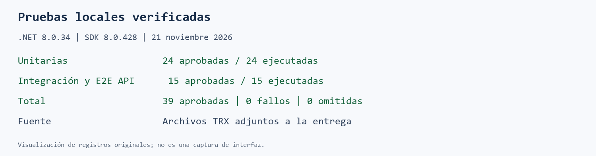
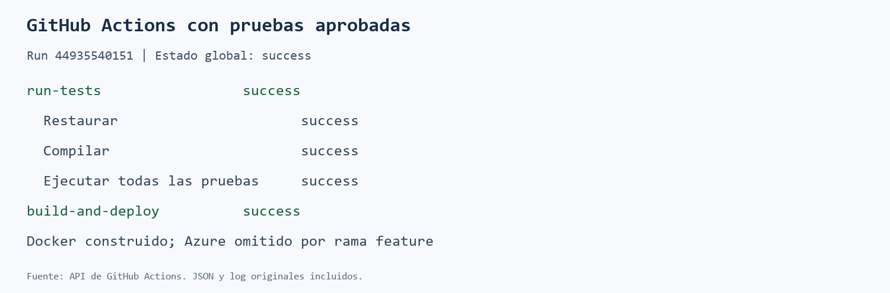
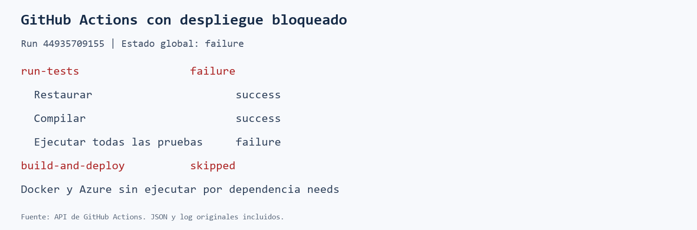

# Resolución del trabajo práctico 4

Universidad Tecnológica Nacional - Facultad Regional Tucumán

Ingeniería y Calidad del Software 2026

Comisión 4K1 - Legajos 58593 58605 50470 58648 57658

Fecha de validación 21 de noviembre de 2026

## Resultado de la implementación

El backend cuenta con 39 pruebas automatizadas aprobadas: 24 unitarias y 15 de integración y E2E a nivel de API. Se incorporaron los dos proyectos de pruebas a la solución y se actualizó GitHub Actions para exigir su aprobación antes de construir Docker o desplegar en Azure.

La verificación incluyó una ejecución exitosa en GitHub y una ejecución negativa controlada. En esta última falló una prueba real de validación de stock y el job dependiente de construcción y despliegue quedó omitido. Los registros originales, los resultados TRX y las visualizaciones de evidencia acompañan este informe.

La entrega se encuentra en la rama test/tp4-testing-documentacion del repositorio ICS2026-backend, siguiendo el formato test/{tarea_realizada} exigido. El desarrollo parte del commit b0ac7fb de development. El frontend está fuera del alcance de los dos documentos de consigna.

## Organización del informe

1. Alcance y arquitectura de las pruebas.
2. Casos unitarios obligatorios.
3. Casos de integración obligatorios.
4. Flujo E2E y correcciones verificadas.
5. Integración continua y control del despliegue.
6. Evidencia de la ejecución exitosa y del bloqueo.
7. Reproducción, trazabilidad y conclusiones.

<!-- pagebreak -->

## Alcance y arquitectura

La resolución sigue el enunciado ICS2026_TP4 y la guía de implementación de testing .NET. Se prueban creación de productos, creación de órdenes y listado del catálogo. Las pruebas E2E se realizan mediante solicitudes HTTP al backend, sin interfaz gráfica.

### Organización de la solución

La solución Dsw2025Tpi.sln conserva las capas Api, Application, Data y Domain. En tests se agregan ECommerce.UnitTests y ECommerce.IntegrationTests. El primer proyecto referencia Application y utiliza IRepository como límite de aislamiento. El segundo referencia la API y ejecuta los controladores, middleware, autenticación, servicios y EfRepository reales.

| Nivel | Herramientas | Dependencias ejercitadas |
| --- | --- | --- |
| Unitarias | xUnit 2.9.2, Moq 4.20.72, FluentAssertions 6.12.1 | Servicios y entidades; repositorio simulado |
| Integración | WebApplicationFactory 8.0.17, EF Core SQLite 9.0.7 | Routing, JWT, controladores, servicios y SQLite |
| E2E API | HttpClient y login real | Login, catálogo, alta, compra y consulta |
| Evidencia | TRX y Coverlet 6.0.2 | Resultados por caso y cobertura recolectada |

### Aislamiento de SQLite

CustomWebApplicationFactory utiliza el entorno Testing y sustituye los dos contextos SQL Server por SQLite. Cada base tiene un nombre único, Mode=Memory y Cache=Shared. Las conexiones permanecen abiertas mientras vive la fábrica. La base de negocio y la de Identity están separadas porque sus modelos y ciclos de creación son diferentes.

Cada caso reinicia ambas bases con EnsureDeleted y EnsureCreated; después crea los roles Admin y User y sus usuarios de prueba. La colección IntegrationTests deshabilita el paralelismo para evitar que una limpieza afecte a otra prueba. El programa omite migraciones SQL Server y cargas desde JSON sólo en Testing.

### Autenticación efectiva

Los clientes autenticados obtienen el token mediante POST /api/auth/login y lo envían como Bearer. Se utilizan contraseñas y clave JWT exclusivas de pruebas. No se reemplaza el esquema de autenticación por un manejador ficticio. Los casos 401, 403 y JWT adulterado verifican el comportamiento del middleware real.

<!-- pagebreak -->

## Casos unitarios obligatorios

Cada prueba sigue Arrange, Act y Assert. Los mocks estrictos fallan ante llamadas no previstas. En escenarios inválidos se verifica que no existan escrituras; cuando la regla exige rechazar antes de consultar el repositorio, VerifyNoOtherCalls verifica ese límite.

| ID | Datos o condición | Resultado comprobado |
| --- | --- | --- |
| UT01 | Producto con SKU único, precio 125,50 y stock 10 | Respuesta equivalente, ID no vacío, activo y Add exactamente una vez |
| UT02 | El mock devuelve un producto con el SKU recibido | DuplicatedEntityException con el SKU y ninguna llamada a Add |
| UT03 | Stock 0, stock -1 o precio -0,01 | InvalidDataException con mensaje antes de consultar o guardar |
| UT04 | Dos productos, cantidades 3 y 2, precios 10,25 y 20,50 | Total 71,75, subtotales coherentes, stock 7 y 6, Update por producto y Add de orden |
| UT05 | Stock disponible 2 y pedido de 5 unidades | InsufficientStockException; stock original y ninguna escritura |
| UT06 | GetById de cliente devuelve null | CustomerNotFoundException; sin consultar productos ni crear orden |
| UT07 | Lista con un producto activo y otro inactivo | Sólo el activo en el resultado público y total 1 |
| UT08 | 15 productos; página 2 de tamaño 5 | SKU 06 a 10 y total 15 antes de paginar |
| UT09 | Coincidencia parcial en nombre, SKU o código interno | Sólo el producto coincidente, ignorando mayúsculas y minúsculas |

En los casos de catálogo, el mock aplica a una colección mixta la expresión recibida por GetFiltered. De esta manera se verifica el predicado construido por el servicio, sin depender de una base de datos. La traducción real de esa expresión se comprueba por separado en SQLite.

Los nombres completos de los métodos se encuentran en matriz-requisitos.md. Las teorías de stock, búsqueda y valores límite generan varias ejecuciones por escenario nominal. El total de pruebas unitarias ejecutadas es 24, sin pruebas dummy ni casos omitidos.

<!-- pagebreak -->

## Casos de integración obligatorios

Las solicitudes se envían al servidor de prueba de ASP.NET Core mediante HttpClient. Las verificaciones de persistencia abren un scope nuevo y consultan SQLite; no se limitan a revisar el objeto devuelto por el controlador.

| ID | Solicitud y preparación | Resultado comprobado |
| --- | --- | --- |
| IT01 | POST /api/products sin JWT y con usuario User | 401 y 403 respectivamente; ninguna fila insertada |
| IT02 | POST /api/products con login Admin y datos válidos | 201, Location utilizable y fila SQLite con ID y valores correctos |
| IT03 | SKU previamente insertado; segundo POST del mismo SKU | 400 y mensaje con el SKU; sólo una fila en SQLite |
| IT04 | POST /api/orders sin token | 401 Unauthorized |
| IT05 | Cliente y producto con stock 10; compra de 3 unidades | 201, Location, orden e ítem persistidos, total 37,50 y stock 7 |
| IT06 | Producto con 10 unidades; compra de 20 | 400, JSON con mensaje de stock, ninguna orden y stock 10 |
| IT07 | GET /api/products público con producto sembrado | 200 y propiedades productItems, totalItems y total coherentes |
| IT08 | Tres productos; search=mOuSe y paginación por query string | Sólo Mouse Gamer y total filtrado 1 desde SQLite |
| IT09 | GET /api/products/admin con producto inactivo | Admin recibe ambos productos; el catálogo público sólo el activo |

El enunciado admite tanto 409 como 400 para SKU duplicado. Se conserva el 400 del middleware existente y se comprueba que el error no se transforme en un 500. El nombre nominal del método conserva la denominación ReturnsConflictStatusCode de la consigna y el comentario del test explica la respuesta elegida.

El contrato previo del catálogo devolvía total, utilizado por el frontend. Para satisfacer totalItems sin romper ese consumidor, se incorpora una propiedad de lectura que publica el mismo valor bajo ambos nombres. El total corresponde al conjunto filtrado antes de aplicar Skip y Take.

Los nueve escenarios nominales obligatorios se amplían con variantes y casos de regresión. El proyecto de integración ejecuta 15 pruebas en total, incluyendo un flujo E2E de API.

<!-- pagebreak -->

## Flujo E2E y correcciones verificadas

### Flujo completo de compra

E2E_LoginCreateProductPurchaseAndReadOrder_PreservesInventoryAndTotals obtiene tokens por login, crea un producto como Admin, lo busca en el catálogo, compra tres unidades como User y consulta la orden y el producto por HTTP. Comprueba total 37,50, cantidad 3 y stock final 7. SQLite contiene una única orden al finalizar.

El cliente de negocio se siembra como dato previo y se vincula al usuario por su email. El flujo integra las rutas reales de autenticación, productos y órdenes. No requiere Postman, un navegador ni un servidor externo.

### Búsqueda del catálogo

La implementación anterior dependía de la sensibilidad a mayúsculas del proveedor. Se normalizan término y campos con ToLower para nombre, SKU y código interno. Las teorías unitarias verifican los tres campos y la integración valida la traducción en SQLite. También se rechazan números de página o tamaños no positivos antes de consultar el repositorio.

### Validación integral de una orden

Antes se descontaba y guardaba el stock de cada ítem inmediatamente. Si un ítem posterior fallaba, podía quedar stock descontado sin una orden. Ahora se validan todos los productos y las cantidades acumuladas de productos repetidos antes de efectuar escrituras.

La persistencia del inventario y de la orden se agrupa en ExecuteInTransaction. Si la inserción falla, se revierte la transacción y se limpia el seguimiento del contexto. Un test adicional fuerza una violación real de clave foránea después de guardar stock y confirma desde un nuevo scope que el stock vuelve a 10 y no existe ninguna orden.

### Casos adicionales

Se prueban precio cero permitido por la regla de precio no negativo, nombre o SKU vacío, paginación inválida, orden sin ítems, cantidades cero o negativas, demanda acumulada insuficiente de un producto repetido y fallo de un ítem posterior. En HTTP se agregan catálogo vacío 204 y token adulterado 401.

La transacción garantiza atomicidad de las escrituras de una orden. No reemplaza un control de concurrencia entre compras simultáneas; esa condición y las particularidades de SQL Server quedan fuera de esta suite SQLite. La resolución no atribuye cobertura de carga ni de despliegue productivo a estas pruebas.

<!-- pagebreak -->

## Integración continua y control del despliegue

El archivo .github/workflows/deploy-main.yml responde a push en development, main, test/** y feature/tp4-*, a pull_request hacia development o main y a ejecuciones manuales. La solución usa SDK .NET 8 y configuración Release en todos los casos.

### Dependencia entre jobs

run-tests restaura paquetes, compila y ejecuta dotnet test con resultados TRX y cobertura. build-and-deploy declara needs: run-tests. Si falla una prueba, GitHub omite el job dependiente. No se configura continue-on-error ni una condición que eluda el éxito del job de pruebas.

El step de carga de artefactos utiliza always para preservar evidencia aun cuando una prueba falle. Esta condición no está aplicada a Docker ni al despliegue. Un step adicional publica el fallo en el resumen de Actions; el estado del workflow comunica el error en la ejecución y en los checks del PR.

### Construcción y publicación

Los PR y la rama de entrega construyen una imagen local identificada por github.sha, sin usar secretos. La publicación en Docker Hub y el despliegue sólo se habilitan fuera de un PR y sobre main o development, después de aprobar el quality gate.

En esas ramas se etiqueta la imagen por SHA y como latest. Azure recibe la etiqueta SHA para identificar exactamente la versión. Se mantienen los nombres de secretos de la configuración existente: DOCKERHUB_USERNAME, DOCKERHUB_TOKEN, APP_SERVICE_NAME y AZURE_WEBAPP_PUBLISH_PROFILE. Ningún valor de esos secretos forma parte del código o del informe.

### Demostración de fallo

El parámetro manual demonstrate_failure inyecta una regresión en el checkout efímero del runner: la condición de stock inválido pasa de menor o igual a cero a menor que cero. La prueba de stock cero detecta el cambio y devuelve un código de salida distinto de cero. La mutación no se guarda en Git ni modifica la rama de entrega.

La demostración es reproducible y deja artefactos con el fallo. En las ejecuciones normales el parámetro es false y el código permanece intacto. La dependencia needs es común a push, PR y ejecución manual.

<!-- pagebreak -->

## Evidencia de ejecución exitosa

La validación local final se realizó con SDK 8.0.428 y runtime .NET 8.0.34. El resultado fue 24 de 24 unitarias y 15 de 15 de integración/E2E, sin fallos ni omisiones. Los TRX conservan el resultado individual de cada caso y el registro de consola conserva las salidas de ejecución.



Figura 1. Visualización generada a partir de los TRX originales incluidos en evidencias. Las imágenes de este informe representan registros verificables; no se presentan como capturas de una interfaz web.

La ejecución 44935540151 de GitHub Actions aprobó el quality gate y construyó la imagen Docker en Ubuntu. La publicación y Azure se omitieron por la política de ramas en la rama inicial feature/tp4-testing-documentacion. La entrega final usa test/tp4-testing-documentacion. La evidencia prueba construcción de imagen; no se realizó un despliegue productivo.



Figura 2. Estados y pasos obtenidos de la API de GitHub; el JSON y el log completos acompañan la entrega.

Ejecución verificable: [GitHub Actions 44935540151](https://github.com/sinergia-ics/ICS2026-backend/actions/runs/44935540151).

<!-- pagebreak -->

## Evidencia del despliegue bloqueado

La ejecución manual 44935709155 utilizó demonstrate_failure=true sobre la misma rama. La restauración y la compilación aprobaron. El step Ejecutar todas las pruebas falló al detectar que se aceptaba stock cero. GitHub clasificó run-tests como failure y Construir imagen y desplegar como skipped, sin ejecutar pasos del segundo job.



Figura 3. El estado skipped del job dependiente procede del JSON de la ejecución, no de una simulación del pipeline.

Esta prueba distingue un fallo real de test de un error de compilación o de credenciales. Los resultados fallidos se conservaron como artefactos aun cuando la ejecución general terminó en failure. El repositorio conserva la validación correcta de stock menor o igual a cero.

Los archivos ci-bloqueada.json, ci-bloqueada.txt y los TRX remotos permiten comprobar la causa del fallo y la ausencia de ejecución de Docker/Azure. La política normal de publicación por ramas no sustituye a needs: el job completo quedó omitido antes de evaluar sus steps.

Ejecución verificable: [GitHub Actions 44935709155](https://github.com/sinergia-ics/ICS2026-backend/actions/runs/44935709155).

<!-- pagebreak -->

## Reproducción y revisión de la entrega

Con un SDK .NET 8 compatible, ejecutar desde la raíz del backend los siguientes comandos. La restauración requiere NuGet; la suite no requiere SQL Server, Azure ni credenciales externas.

```powershell
dotnet restore Dsw2025Tpi.sln
dotnet build Dsw2025Tpi.sln --no-restore -c Release
dotnet test Dsw2025Tpi.sln --no-build -c Release --logger trx
```

Para ejecutar sólo el flujo completo de API:

```powershell
dotnet test tests/ECommerce.IntegrationTests -c Release --filter "Category=E2E"
```

Para repetir la prueba negativa, seleccionar el workflow en Actions, elegir la rama de entrega y activar demonstrate_failure. La ejecución debe finalizar en failure y el job dependiente debe quedar skipped. Con el parámetro desactivado se espera el resultado exitoso.

### Archivos de evidencia

Los archivos TRX locales contienen nombres, datos parametrizados, duración y resultado de cada ejecución. Los TRX remotos y la cobertura recolectada por Coverlet se preservan en las subcarpetas github de evidencias. Los JSON de Actions registran jobs y steps; los TXT conservan las salidas del runner. No se utiliza una cifra de cobertura inventada como criterio de aprobación: el gate exige que todas las pruebas pasen.

### Gestión de las tarjetas

Las cuatro tarjetas existentes se relacionan con la entrega en matriz-requisitos.md. CARD-TP4-01 corresponde a infraestructura; CARD-TP4-02 a unitarias; CARD-TP4-03 a integración y E2E; CARD-TP4-04 al workflow y a la demostración del bloqueo.

Los movimientos de listas, la revisión del equipo y el cierre en Done quedan a cargo del equipo por decisión del solicitante. No se modifica ni se fabrica historial de Trello. La rama publicada conserva todos los cambios para su revisión antes de integrar a development.

<!-- pagebreak -->

## Conclusiones y referencias

Los escenarios obligatorios de creación y listado de productos y creación de órdenes cuentan con pruebas verificables. El aislamiento unitario permite detectar reglas inválidas antes de acceder a persistencia; las pruebas HTTP ejercitan seguridad, contratos y almacenamiento real en SQLite. El flujo E2E comprueba la coherencia del total y el inventario a través de varias rutas de la API.

La prueba negativa en GitHub Actions demostró que una regresión de negocio impide iniciar el job de Docker y despliegue. La ejecución positiva demostró que el mismo workflow permite construir la imagen cuando las pruebas aprueban. La documentación y los registros originales permiten reproducir ambos resultados.

La integración final de la rama y la gestión del tablero corresponden al proceso de revisión del equipo. SQLite aporta una base relacional efímera para la suite; no sustituye una validación específica de SQL Server ni un ensayo de concurrencia o carga.

### Fuentes de la consigna

ICS2026_TP4.pdf. Trabajo Práctico número 4. UTN FRT, Ingeniería y Calidad del Software, 2026. Casos unitarios, integración, E2E opcional, quality gate y entregables.

guia-tp4-testing-dotnet-cicd.pdf. Guía de implementación TP4, versión 3. UTN FRT. Alcance exclusivo backend, xUnit, Moq, WebApplicationFactory, SQLite y dependencia entre jobs.

### Referencias técnicas

[Microsoft Learn sobre pruebas de integración en ASP.NET Core](https://learn.microsoft.com/en-us/aspnet/core/test/integration-tests?view=aspnetcore-8.0). Referencia de WebApplicationFactory, servidor de prueba y separación de proyectos.

[GitHub Docs sobre dependencias entre jobs](https://docs.github.com/en/actions/how-tos/write-workflows/choose-what-workflows-do/use-jobs). Comportamiento de needs cuando falla u omite un job previo.

[Repositorio del backend](https://github.com/sinergia-ics/ICS2026-backend). Rama de entrega test/tp4-testing-documentacion.

[Tablero TP4](https://trello.com/b/BPuStRHF). Tarjetas CARD-TP4-01 a CARD-TP4-04.
